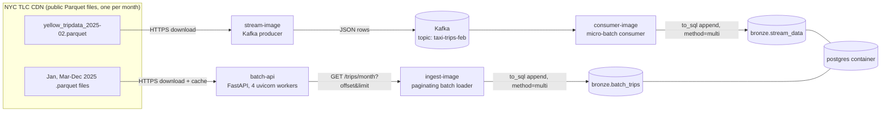

# DE Final Project — NYC Yellow Taxi Pipeline — Status

Data engineering pipeline that lands NYC TLC Yellow Taxi trip data into Postgres via two
genuinely different ingestion mechanisms: a REST API consumed in batch, and Kafka streaming.
No Parquet files are stored in this repo — everything is downloaded from the public NYC TLC
CDN at ingestion time.

## Architecture



| Container | Image name | Role |
|---|---|---|
| `postgres` | `postgres:16` | Holds the `bronze` schema (`batch_trips`, `stream_data`) |
| `kafka` | `apache/kafka:3.7.0` | Single-node KRaft broker (no Zookeeper) |
| `batch-api` | `de-final-project-batch-api-image` | **Source type #1**: FastAPI REST service — downloads+caches each month's Parquet file on first request, serves it paginated as JSON (`/months`, `/trips/{month}`). Runs 4 uvicorn workers. |
| `ingest-image` | `de-final-project-ingest-image` | Consumes the `batch-api` REST API page-by-page and bulk-writes into `bronze.batch_trips` (one-shot) |
| `stream-image` | `de-final-project-stream-image` | **Source type #2**: downloads the Feb-2025 Parquet file directly over HTTPS and publishes rows to Kafka (one-shot producer) |
| `consumer-image` | `de-final-project-consumer-image` | Long-running Kafka consumer, micro-batches into `bronze.stream_data` |

This satisfies the "two different source types" requirement: batch data is pulled through a
REST API (pull/pagination model), while streaming data flows through a Kafka pub/sub topic —
structurally different ingestion mechanisms, even though both ultimately originate from the
same public Parquet files.

Tech stack: plain Python (`pandas`/`pyarrow` for Parquet, `FastAPI`+`uvicorn` for the REST API,
`confluent-kafka` for the producer/consumer, `SQLAlchemy`+`psycopg2-binary` for Postgres). Table
schemas are auto-created from the DataFrame dtypes (no hardcoded DDL). The "data lake"/raw layer
is implemented as a `bronze` Postgres schema in the same database (not separate object storage).

## Project layout

```
DE-final-project/
├── docker-compose.yaml
├── .env / .env.example       # shared config (db creds, kafka topic, batch months, tuning knobs)
├── batch-api-image/{Dockerfile,requirements.txt,app/api.py}
├── ingest-image/{Dockerfile,requirements.txt,app/ingest.py}
├── stream-image/{Dockerfile,requirements.txt,app/producer.py}
└── consumer-image/{Dockerfile,requirements.txt,app/consumer.py}
```

No `data/` directory — all Parquet files are downloaded on demand (and cached in the
`batch_cache` named volume for `batch-api`, and `/tmp` inside the `stream-image` container).

## Configuration (`.env`)

| Variable | Purpose |
|---|---|
| `POSTGRES_*` | Postgres connection details |
| `KAFKA_BOOTSTRAP_SERVERS`, `KAFKA_TOPIC`, `KAFKA_GROUP_ID` | Kafka connection/topic/consumer-group |
| `BRONZE_SCHEMA` | Postgres schema for raw landed data (`bronze`) |
| `BATCH_TABLE_NAME` / `STREAM_TABLE_NAME` | Target table names (`batch_trips` / `stream_data`) |
| `STREAM_SOURCE_URL` | Feb-2025 Parquet URL streamed through Kafka |
| `STREAM_BATCH_SIZE` / `STREAM_INTERVAL_SECONDS` | Producer pacing (rows per chunk / delay between chunks) |
| `CONSUMER_BATCH_SIZE` / `CONSUMER_FLUSH_INTERVAL_SECONDS` | Consumer micro-batch flush thresholds |
| `BATCH_SOURCE_BASE_URL` / `BATCH_MONTHS` | NYC TLC CDN base URL + which months `batch-api` serves (all months except Feb, by default) |
| `BATCH_API_URL` | How `ingest-image` reaches `batch-api` |
| `BATCH_PAGE_SIZE` | Rows per REST API page (100,000 by default) |
| `INGEST_CHUNK_SIZE` | Rows per individual SQL `INSERT` statement (keeps statement compilation fast) |
| `INGEST_MAX_WORKERS` | Size of the ingest process pool (page-level parallelism) |

## Running it

```bash
cd DE-final-project
docker compose up -d postgres kafka batch-api   # wait for all three to report healthy
docker compose up -d consumer-image             # long-running, idles until Kafka messages arrive
docker compose run --rm stream-image            # downloads Feb-2025, publishes rows to Kafka
docker compose run --rm ingest-image            # pulls all other months from batch-api into bronze.batch_trips
```

Check results:
```bash
docker compose exec postgres psql -U de_user -d de_final_project -c "SELECT source_month, count(*) FROM bronze.batch_trips GROUP BY 1 ORDER BY 1;"
docker compose exec postgres psql -U de_user -d de_final_project -c "SELECT count(*) FROM bronze.stream_data;"
```

`ingest-image` is idempotent per month: it skips any `source_month` that already has rows in
`bronze.batch_trips`, so re-running it only loads months that are still missing.

Default `.env` pacing (`STREAM_BATCH_SIZE=500`, `STREAM_INTERVAL_SECONDS=2`) simulates a
realistic live trickle, so a full Feb-2025 replay takes hours by design. For a quick smoke test,
override at run time, e.g.:
```bash
docker compose run --rm -e STREAM_BATCH_SIZE=50000 -e STREAM_INTERVAL_SECONDS=0.5 stream-image
```

## Status (2026-11-09)

- All 4 custom images build successfully; `postgres`, `kafka`, `batch-api` healthchecks pass.
- **Batch path verified**: a full single-month run (2025-01, 3,475,226 rows) completed
  correctly end-to-end through `batch-api` → `ingest-image` → `bronze.batch_trips`, with the
  exact row count landing with zero duplicates/loss despite 4 concurrent worker processes
  writing to the same table.
- **Streaming path verified** (in an earlier iteration of this architecture, same consumer
  logic, now targeting `bronze.stream_data`): all published rows landed with zero Kafka
  consumer lag. `bronze.stream_data` is currently empty pending a fresh run under the current
  table name.
- `batch-api` is currently scoped to serve only `2025-01` (left over from a targeted
  single-month parallelism test). `.env`'s `BATCH_MONTHS` already lists all 11 non-Feb months;
  `batch-api` just needs `docker compose up -d --force-recreate batch-api` to pick it up before
  the next full `ingest-image` run.
- Git repository initialized locally (remote: `https://github.com/DE-final-project/NY-taxi-DE`),
  all files staged, not yet committed/pushed.

## Performance tuning journey (documented optimization)

This went through several real, measured iterations — useful as the project's "cost
optimization / performance tuning" evidence:

1. **Baseline**: `consumer.py`/`ingest.py` used pandas' default `to_sql` (one row per `INSERT`).
   Throughput: ~30 rows/sec when catching up a backlog.
2. **`method="multi"`**: batched multi-row `INSERT` statements. Throughput: ~6,900 rows/sec.
3. **Bigger pages (500K rows) without chunking**: made things *worse* — a single multi-row
   `INSERT` with 500K rows × ~20 columns made SQLAlchemy's pure-Python statement compiler the
   bottleneck (single core pegged at ~100%, ~90-100s per page).
4. **Added `INGEST_CHUNK_SIZE`** (sub-chunking the SQL writes) + reduced `BATCH_PAGE_SIZE` to
   100,000 — restored fast, consistent per-page latency (~18s per 100K-row page).
5. **Month-level parallelism** (`ProcessPoolExecutor`, not `ThreadPoolExecutor`): threads didn't
   help because the work (JSON parsing, SQL statement compilation) is CPU-bound pure Python and
   GIL-bound — confirmed via `docker stats` showing ~100% (1 core) regardless of thread count.
   Switching to processes (each with its own engine) got real multi-core usage (~375% CPU).
6. **`batch-api` was then the bottleneck**: with only 1 uvicorn worker, `docker stats` showed
   `batch-api` pegged at ~100% CPU (JSON-serializing large pages) while `ingest-image` sat idle
   waiting on the response. Added `--workers 4` to uvicorn so the API itself scales too.
7. **Page-level parallelism** (not just month-level): a single month is now also split into
   independent `(month, offset)` page jobs distributed across the process pool, so even a
   one-month run saturates multiple cores (confirmed: 365% CPU on a single-month test, 34 pages
   across 4 workers, exact final row count with no duplicates).
8. Verified no artificial Docker CPU limits exist (`NanoCpus`/`CpusetCpus`/`CpuQuota` all unset,
   host has 32 cores, container `nproc`/cgroup `cpu.max` both confirm full access) — the earlier
   single-core behavior was a software bottleneck, not an infrastructure one.

## Known caveats / further considerations

- Delivery semantics for the streaming path are at-least-once (buffer flushed to Postgres, then
  Kafka offset committed); no dedup key is implemented.
- `ingest-image`'s per-month idempotency check only looks for *any* row with that `source_month`
  — if a run is killed mid-month, re-running will skip that month entirely rather than resuming
  from where it left off (a known, accepted limitation for this project's scope).
- If you manually delete and recreate the Kafka topic or the `batch-api` cache, use a fresh
  `KAFKA_GROUP_ID`/clear `bronze` tables as appropriate — reusing state against recreated
  topics/tables can leave stale/mismatched data (not an issue in normal operation).
- Medallion architecture currently has only the Bronze layer; Silver/Gold (star schema, dbt
  models/tests, incremental loading) are planned but not yet implemented.
- `stream-image` and `ingest-image` are one-shot jobs (run once and exit); `consumer-image` is the only long-running service.
