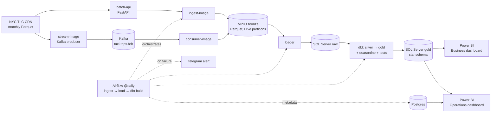

# NYC Yellow Taxi — End-to-End Data Engineering Pipeline

## Problem
NYC publishes ~3–4M yellow-taxi trips per month as raw Parquet files. The data is not
analysis-ready: it contains impossible trips (dropoff before pickup, zero distance, negative
fares, dates outside 2025, meters left running for days), and — because it arrives through two different channels (batch API and
Kafka stream) — duplicate copies of the same trip. This project builds an automated pipeline
that lands it in a lake, cleans it, models it as a star schema in SQL Server, and serves two
Power BI dashboards — one for the business and one for pipeline operations.

## Business questions
1. **When** is demand highest? (weekday × hour)
2. **Where** do trips start — which zones and boroughs bring the most trips and revenue?
3. **How** do riders pay, and how much do they tip? (payment type and tips)

## Architecture


- **Batch:** months `2025-01` and `2025-03` … `2025-12` via REST API (pull, paginated); the list comes from `BATCH_MONTHS` in `.env`.
- **Stream:** month `2025-02` via Kafka (push, micro-batched by the consumer).
- Lineage of the dbt part: [docs/lineage.png](docs/lineage.png) · ERD: [docs/erd.md](docs/erd.md) · Performance: [docs/performance.md](docs/performance.md)

## How to run
**Prerequisites:** Docker Desktop, Power BI Desktop (for the dashboards).

```bash
cp .env.example .env              # fill in passwords (and Telegram token/chat id for alerts)
docker compose up -d --build      # builds all images, starts the long-running services
```
`stream-image`, `ingest-image`, `loader` and `dbt` have `scale: 0`: they are built but not started —
Airflow runs them as `DockerOperator` tasks.

| Step | Command |
|---|---|
| Stream February through Kafka | `docker compose run --rm stream-image` (the consumer writes it to the lake) |
| Run the batch pipeline now | `docker compose exec airflow airflow dags trigger ny_taxi_pipeline` (otherwise it runs `@daily`) |
| Airflow UI | http://localhost:8080 |
| MinIO console (the lake) | http://localhost:9001 |
| SQL Server (raw / silver / gold) | `localhost,1436` |
| dbt docs + lineage | `docker compose run --rm dbt dbt docs generate` then `docker compose run --rm -p 8081:8081 dbt dbt docs serve --port 8081 --host 0.0.0.0` |
| Unit tests (Python) | `cd loader-image && pytest -v` (also run by GitHub Actions on every push) |
| Unit tests (dbt) | `docker compose run --rm dbt dbt test --select test_type:unit` (`silver_trips` cleaning + batch-wins dedup) |
| Dashboards | open `powerbi/business/NY Taxi Business.pbip` and `powerbi/operations/NY Taxi Operations.pbip` → Refresh |

## Status
Latest work on `main` (PR #1 silver layer, PR #2 `omar/work`):

| Area | State |
|---|---|
| Sources: batch REST API (Jan, Mar–Dec) + Kafka stream (Feb) | ✅ |
| Bronze lake (MinIO, Parquet, Hive partitions) → SQL Server `raw` | ✅ file-level incremental load, schema evolution |
| Silver / Gold with dbt (quarantine, dedup, star schema, `pipeline_metrics`, `dq_reject_summary`) | ✅ |
| Data quality | ✅ dbt data tests + reconciliation (`raw = silver + quarantine`) + 1 dbt unit test |
| Orchestration: Airflow `ny_taxi_pipeline` (`@daily`, 2 retries) + Telegram failure alerts | ✅ |
| Structured JSON logging in all pipeline images (one JSON object per line) | ✅ |
| CI: GitHub Actions (loader pytest + `dbt parse`) | ✅ |
| Dashboards: Power BI Business + Operations (`.pbip`) | ✅ |
| Docs: lineage, ERD, model descriptions, performance measurements | ✅ |

**Known gaps:** the stream is not part of the Airflow DAG (run it with `docker compose run --rm stream-image`);
the DAG has `catchup=False`, so months are loaded by the ingest step, not by per-month DAG runs; logs are not aggregated
in a UI; `dbt-project/ny_taxi_silver/` is an earlier standalone dbt project kept from PR #1 — the pipeline,
Compose and CI use `dbt-image/ny_taxi/`.

## Project layout
| Path | What |
|---|---|
| `batch-api-image/`, `ingest-image/` | REST source and the job that pulls it into the lake |
| `stream-image/`, `consumer-image/` | Kafka producer (February) and the micro-batch consumer into the lake |
| `loader-image/` | Lake → SQL Server `raw` (bulk copy, `load_log`, schema evolution) + pytest |
| `dbt-image/ny_taxi/` | dbt project used by the pipeline: `silver`, `gold`, seeds, tests, unit tests |
| `airflow/dags/` | `ny_taxi_pipeline` DAG |
| `powerbi/` | Business and Operations dashboards |
| `docs/` | Lineage, ERD, performance |
| `dbt-project/ny_taxi_silver/` | Earlier dbt project (not used by Compose/CI) |

## Design decisions
| Layer | Tool | Why | Alternatives considered |
|---|---|---|---|
| Batch source | FastAPI (`batch-api`) | A real REST source (pull, paginated) that is different from the stream | Reading the Parquet files directly (would not be a second source type) |
| Stream source | Kafka 3.7 (KRaft) | Real pub/sub streaming, replayable, industry standard | RabbitMQ (no replay), Kinesis (cloud only, paid) |
| Data lake (bronze) | MinIO + Parquet, Hive partitions | S3-compatible object storage that runs locally; Parquet is columnar and compressed | AWS S3 (paid), HDFS (heavy to run), raw tables in a DB (not a lake) |
| Warehouse | SQL Server 2022 | Required by the project; columnstore indexes fit analytics | PostgreSQL, Snowflake |
| Raw load | Python + `pymssql.bulk_copy` | Bulk copy is far faster than row INSERTs; file-level incremental via `load_log` | Spark (overkill for ~10M rows), SSIS (Windows only) |
| Transform | dbt | SQL models + tests + incremental + docs/lineage in one tool, version-controlled | Stored procedures (no tests/lineage), Spark |
| Orchestration | Airflow 3 (`DockerOperator`) | Retries, schedule, failure callbacks, run history in Postgres | Prefect, Dagster, cron (no retries or history) |
| Alerting | Telegram bot | Instant on the phone, a single HTTP call | E-mail (SMTP setup), Slack (workspace needed) |
| Serving | Power BI (`.pbip` in git) | Strong modeling (DAX) and the project files are diff-able text | Superset, Metabase, Tableau |
| Packaging | Docker Compose | Whole platform starts with one command, same on every machine | Kubernetes (too heavy for one laptop) |

**Data quality:** rows that break a rule go to `silver.quarantine_trips` with a `reject_reason`, never silently dropped.
The test `assert_no_rows_lost` proves `raw = silver + quarantine` on every run.
**Schema evolution:** the loader compares each new file's schema with the raw table — a new source column is added
with `ALTER TABLE ADD` (and logged as a warning), a missing one is loaded as NULL; staging models select columns
by name, so dbt does not break.

## Challenges and how we solved them
| Challenge | Solution |
|---|---|
| Stream replay produced **24,081 duplicate trips** — caught by the `assert_no_rows_lost` reconciliation test | Hash-based `trip_id` macro, keep one copy per trip (batch wins), extra copies quarantined as `duplicate` |
| `batch-api` worker killed by **out-of-memory** with 4 parallel ingest workers | `INGEST_MAX_WORKERS=2` + Airflow retries |
| `pymssql` bulk copy garbled `NVARCHAR` text | Raw text columns are `VARCHAR` |
| Official MinIO image removed from Docker Hub | Pinned community build `pgsty/minio` |
| SQL Server transaction log grew without bound during bulk loads | `RECOVERY SIMPLE` on the dev database |
| A broken YAML file failed the nightly run | GitHub Actions runs `dbt parse` + pytest on every push |
| Early ingest wrote ~30 rows/s | Multi-row inserts, then process-level parallelism (see [docs/performance.md](docs/performance.md)) |
